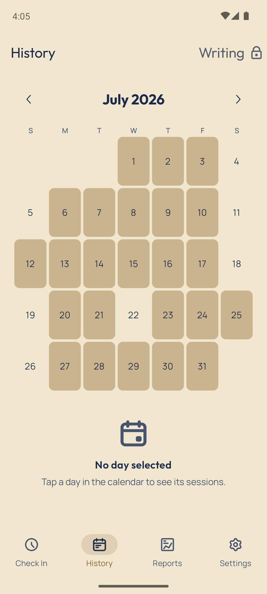
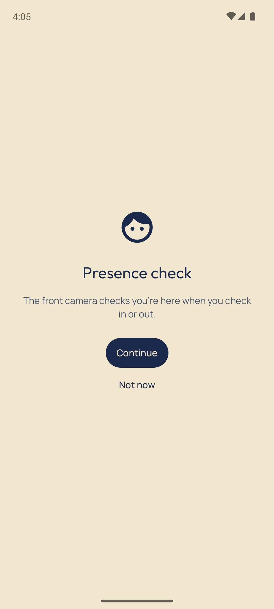
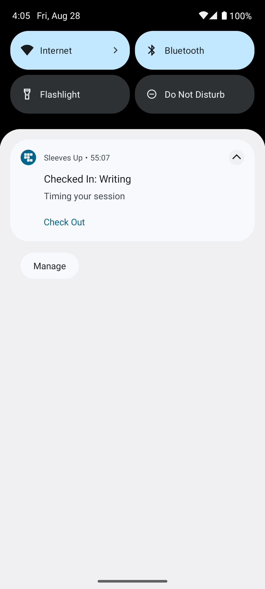
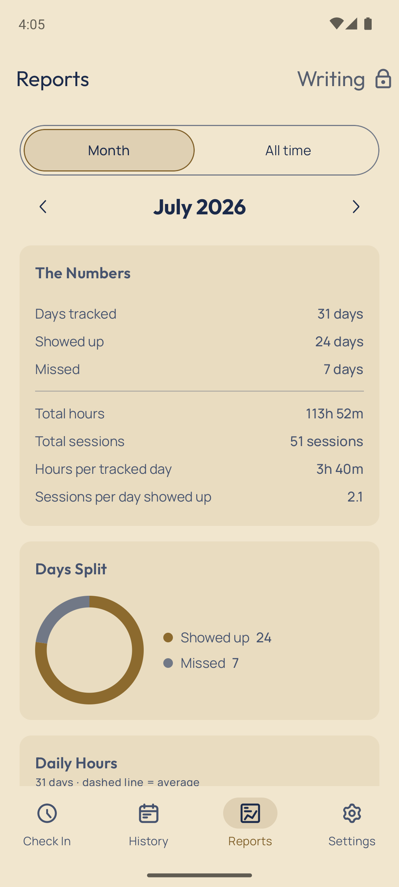

# Sleeves Up

A personal Android tracker built around **showing up**. It records time through presence-checked
**check-in / check-out** intervals and shows the record building up. There is no target and no
grade: a day counts because you turned up for it, not because its hours cleared a bar.

| | | | |
| --- | --- | --- | --- |
|  |  |  |  |

## What it does

- **Check in / check out**, each gated by an on-device face check with **device unlock** as the
  fallback. No photo is taken: the camera hardware reports whether a face is in frame and the app
  reads only that count.
- **A day counts if it has a session** — 45 minutes counts exactly as much as nine hours, every day
  of the week. Daily time is the sum of completed intervals. Hours appear in totals, charts and the
  export as a plain quantity: nothing is ranked against your best, and nothing is coloured red.
- **Today counts the moment you check out**, and never shows as missed before then, so the numbers
  only move up during a day.
- **Sessions are immutable** — no editing, deleting or manual entry.
- **A session reminder** every two hours while you're checked in; ignoring it costs nothing. A
  session you forget closes itself at midnight.
- **Habits** — a separate record for each thing you're showing up for. The top-bar switcher picks
  the habit every tab shows; nothing compares one habit with another. One session runs at a time,
  and the switcher stays on its habit until you check out. Habits are archived rather than deleted
  and can be restored, records intact, from the Habits screen.
- **Check-in reminders** — on by default, one per habit, around the time you choose, only on a day
  that habit has no session. Turn one off like any notification: long-press it, or find the habit's
  channel under **Habit Reminders** in Android's settings for the app.
- **Self-contained** — Room-only storage, no backend, no internet permission. CSV export via the
  share sheet. The record, habits and reminder times travel in Android's own cloud backup when the
  user has it turned on, and in a device-to-device transfer, so a new phone restores them.
- **English (UK) and Arabic**, chosen through Android's per-app language setting.

## Tabs

| Tab | What it shows |
| --- | --- |
| **Check In** | Live timer and the check-in/out button, with today's sessions a tap away |
| **History** | Monthly calendar marking every day you showed up; tap a day for its sessions |
| **Reports** | A month or all time: the numbers, days split, daily hours, hours by month, start times, sessions per day, and CSV export of that span |
| **Settings** | Manage habits (names, reminder times, archive, restore), app language, and About: privacy, feedback, licences |

## Requirements

- Android Studio (ships the JetBrains JDK 21 the Gradle daemon needs)
- A device or emulator on **Android 12+** (min SDK 31; compile/target SDK 36)
- **Notifications** permission, asked after the first-run tour; **Camera**, asked at the first check-in

## Build & run

The Gradle wrapper is pinned to **Gradle 9.8.2**. In Android Studio, open the project and Run. For
CLI builds, point Gradle at Android Studio's bundled JDK:

```bash
export JBR="/Applications/Android Studio.app/Contents/jbr/Contents/Home"
./gradlew :app:testDebugUnitTest -Dorg.gradle.java.installations.paths="$JBR"  # JVM unit tests
./gradlew :app:assembleDebug     -Dorg.gradle.java.installations.paths="$JBR"  # debug APK
./gradlew :app:installDebug      -Dorg.gradle.java.installations.paths="$JBR"  # install on a device
./gradlew :app:testDebugUnitTest --tests "com.checkin.app.ConsistencyStatsTest"  # one test class
```

## Checks

```bash
./gradlew staticAnalysis              # ktlint + detekt (no baseline: fix or suppress at the site)
./gradlew ktlintFormat                # auto-fix formatting
./gradlew :app:verifyDocMap           # CLAUDE.md and the source tree agree
./gradlew :app:verifyLicenseCoverage  # in-app licence list matches the release classpath
./gradlew :app:verifyMergedManifest   # merged release manifest matches app/merged-manifest-allowlist.txt
./gradlew :app:verifyPackagedFonts    # release APK carries only the app's own res/font typefaces
./gradlew :app:lintDebug              # Android lint
```

CI runs all of these on push and PR to `main` and to every version branch, cheapest first. To run `staticAnalysis` before each
commit (once per clone):

```bash
git config core.hooksPath githooks
```

The hook only runs when Kotlin is staged, and always refuses to commit a keystore,
`keystore.properties` or `local.properties`.

## Tech

Kotlin · Jetpack Compose (Spark over Material 3, a fixed ink-and-brass theme, light + dark) · Room via KSP · a
`specialUse` foreground service for the live timer notification · CameraX + Camera2 HAL face
detection · BiometricPrompt fallback · WorkManager. MVVM, one reactive `UiState` per screen, manual
DI (`AppContainer`). See [`CLAUDE.md`](CLAUDE.md) for architecture, conventions and non-obvious
behaviour.

## License

Apache License 2.0 — see [`LICENSE`](LICENSE). Third-party licences the app redistributes are listed
in-app under **Settings → Licences**. The list is hand-maintained, and
`./gradlew :app:verifyLicenseCoverage` fails the build if it and the release runtime classpath
disagree in either direction.
