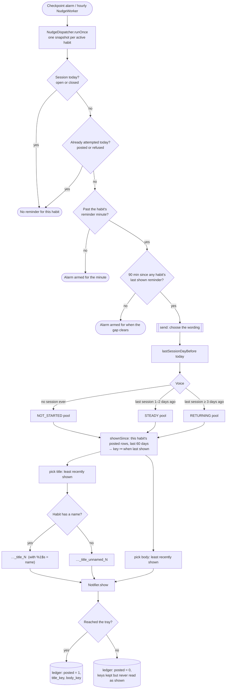
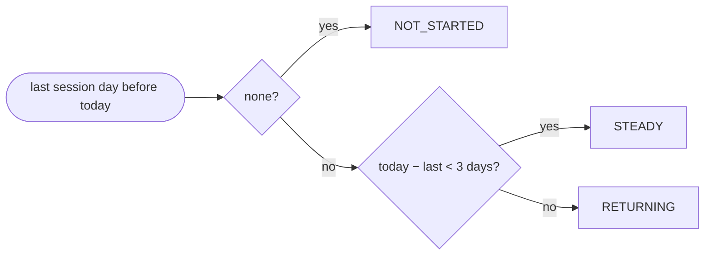
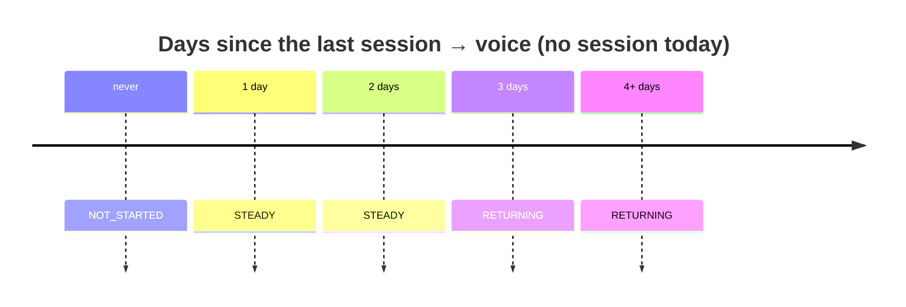
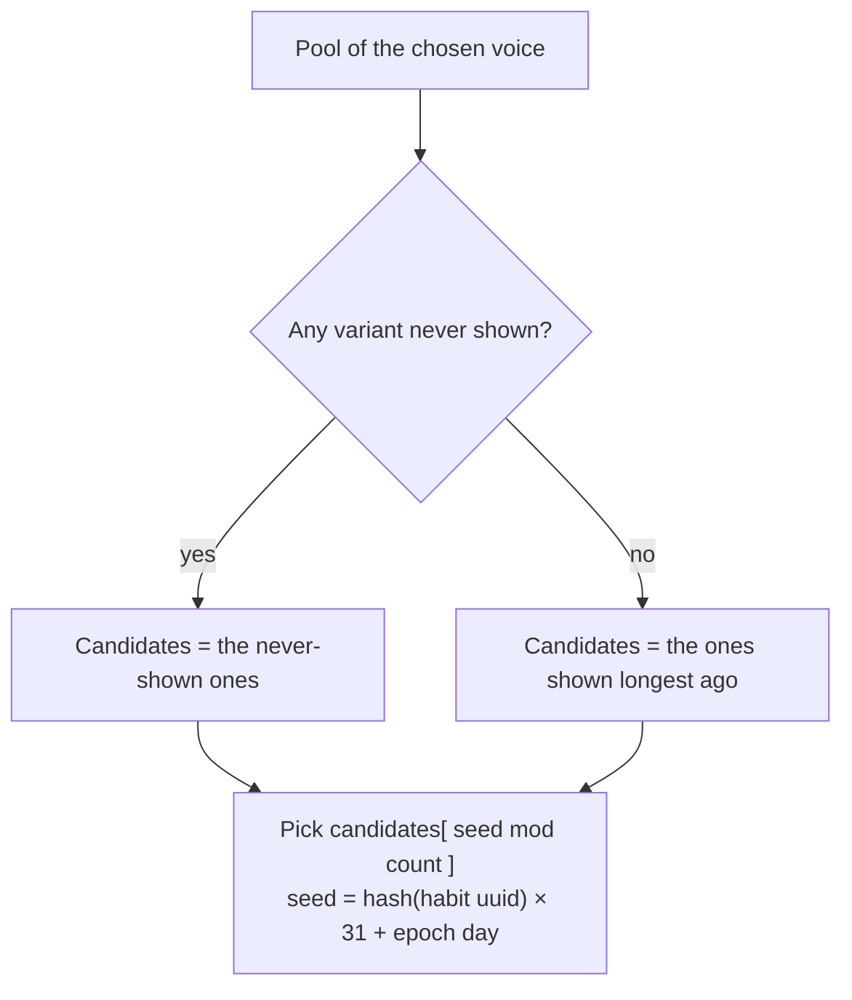

# Nudge voices: which reminder text comes when

How a habit's daily reminder picks its title and body. Every name below is a `<string name>` in
`app/src/main/res/values/strings.xml`, with an Arabic twin of the same name in `values-ar/`. The
code is `notify/nudge/NudgeVoice.kt` (voice and pick), `NudgeCatalog.kt` (the pools) and
`NudgeDispatcher.send` (the wiring). **Keep this file in step with `NudgeCatalog`**: nothing checks
that they agree.

## 1. The whole path, one pass

The checkpoint alarm or the hourly worker starts a pass. The voice and wording are decided only
after eligibility has already said a reminder goes out, and they never change *whether* or *when*
it is sent.

## 2. Choosing the voice

One fact decides it: the habit's **last session day before today** (`MAX(date_key) … < today`). An
open session counts, because a check-in is a day the user showed up. Hours, session counts and other
habits are never read.

| Today − last session | Voice | Note |
|---|---|---|
| never had one | `NOT_STARTED` | a new habit, or one never checked into |
| 1 day (yesterday) | `STEADY` | |
| 2 days | `STEADY` | one empty day is ordinary life |
| 3 days or more | `RETURNING` | `RETURNING_AFTER_DAYS = 3` |
| last session "after" today | `STEADY` | only possible when the clock is moved back |
| the session read fails | `STEADY` | wording is never worth losing the reminder |

A session today means no reminder at all, so no voice is ever chosen on a day already shown up for.

## 3. The pools

Each voice has 4 titles, each with an unnamed twin, and 12 bodies. The title and body are picked
**independently**, so a voice has 48 combinations. A key is what the ledger stores, and is frozen
once shipped.

### NOT_STARTED

| Key | Title (named) | Title (unnamed) |
|---|---|---|
| `not_started.t1` | `nudge_not_started_title_1` | `nudge_not_started_title_unnamed_1` |
| `not_started.t2` | `nudge_not_started_title_2` | `nudge_not_started_title_unnamed_2` |
| `not_started.t3` | `nudge_not_started_title_3` | `nudge_not_started_title_unnamed_3` |
| `not_started.t4` | `nudge_not_started_title_4` | `nudge_not_started_title_unnamed_4` |

| Key | Body | Key | Body |
|---|---|---|---|
| `not_started.b1` | `nudge_not_started_body_1` | `not_started.b7` | `nudge_not_started_body_7` |
| `not_started.b2` | `nudge_not_started_body_2` | `not_started.b8` | `nudge_not_started_body_8` |
| `not_started.b3` | `nudge_not_started_body_3` | `not_started.b9` | `nudge_not_started_body_9` |
| `not_started.b4` | `nudge_not_started_body_4` | `not_started.b10` | `nudge_not_started_body_10` |
| `not_started.b5` | `nudge_not_started_body_5` | `not_started.b11` | `nudge_not_started_body_11` |
| `not_started.b6` | `nudge_not_started_body_6` | `not_started.b12` | `nudge_not_started_body_12` |

### STEADY

Variant 1 keeps the names the single pre-voice reminder shipped under.

| Key | Title (named) | Title (unnamed) |
|---|---|---|
| `steady.t1` | `nudge_not_checked_in_title` | `nudge_not_checked_in_unnamed_title` |
| `steady.t2` | `nudge_steady_title_2` | `nudge_steady_title_unnamed_2` |
| `steady.t3` | `nudge_steady_title_3` | `nudge_steady_title_unnamed_3` |
| `steady.t4` | `nudge_steady_title_4` | `nudge_steady_title_unnamed_4` |

| Key | Body | Key | Body |
|---|---|---|---|
| `steady.b1` | `nudge_not_checked_in_body` | `steady.b7` | `nudge_steady_body_7` |
| `steady.b2` | `nudge_steady_body_2` | `steady.b8` | `nudge_steady_body_8` |
| `steady.b3` | `nudge_steady_body_3` | `steady.b9` | `nudge_steady_body_9` |
| `steady.b4` | `nudge_steady_body_4` | `steady.b10` | `nudge_steady_body_10` |
| `steady.b5` | `nudge_steady_body_5` | `steady.b11` | `nudge_steady_body_11` |
| `steady.b6` | `nudge_steady_body_6` | `steady.b12` | `nudge_steady_body_12` |

### RETURNING

| Key | Title (named) | Title (unnamed) |
|---|---|---|
| `returning.t1` | `nudge_returning_title_1` | `nudge_returning_title_unnamed_1` |
| `returning.t2` | `nudge_returning_title_2` | `nudge_returning_title_unnamed_2` |
| `returning.t3` | `nudge_returning_title_3` | `nudge_returning_title_unnamed_3` |
| `returning.t4` | `nudge_returning_title_4` | `nudge_returning_title_unnamed_4` |

| Key | Body | Key | Body |
|---|---|---|---|
| `returning.b1` | `nudge_returning_body_1` | `returning.b7` | `nudge_returning_body_7` |
| `returning.b2` | `nudge_returning_body_2` | `returning.b8` | `nudge_returning_body_8` |
| `returning.b3` | `nudge_returning_body_3` | `returning.b9` | `nudge_returning_body_9` |
| `returning.b4` | `nudge_returning_body_4` | `returning.b10` | `nudge_returning_body_10` |
| `returning.b5` | `nudge_returning_body_5` | `returning.b11` | `nudge_returning_body_11` |
| `returning.b6` | `nudge_returning_body_6` | `returning.b12` | `nudge_returning_body_12` |

## 4. Picking within a pool

`NudgeVoice.pick` is run once for the titles and once for the bodies, over the habit's **posted**
rows from the last 60 days (`NudgeVoice.HISTORY_MS`).

What follows from that:

- **No repeat until the pool has turned.** Twelve reminders in one voice carry twelve different
  bodies, and four carry four different titles.
- **A refused post doesn't use its wording.** Refused rows are left out of the history, so the line
  stays never-shown and is still a candidate next time.
- **Each voice rotates on its own.** Keys are per voice (`steady.*` vs `returning.*`), so moving
  between voices neither resets nor spends the other pool.
- **The seed only breaks ties.** It's stable within a day and differs across days and habits, so two
  habits, or a fresh install, don't all open on variant 1.
- **An unreadable history** counts as empty: the seed alone picks, and the reminder still posts.

## 5. Worked example

One habit, "Reading", reminder at 10:00, sample uuid `3f6c2a9e-8d41-4b7a-9c1e-5a2b7d0e4f18`. The picks
are computed with the shipped algorithm for this uuid; a different uuid gives a different order, but
the same rules.

| Date | What happened | Last session (gap) | Voice | Title | Body |
|---|---|---|---|---|---|
| Mon 2 Nov | habit created, nothing yet | never | `NOT_STARTED` | `nudge_not_started_title_1` | `nudge_not_started_body_5` |
| Tue 3 Nov | still nothing | never | `NOT_STARTED` | `nudge_not_started_title_4` | `nudge_not_started_body_8` |
| Wed 4 Nov | checked in at 08:00, before the reminder | — | — | *no reminder* | *no reminder* |
| Thu 5 Nov | no session | 4 Nov (1 d) | `STEADY` | `nudge_steady_title_4` | `nudge_steady_body_8` |
| Fri 6 Nov | no session | 4 Nov (2 d) | `STEADY` | `nudge_steady_title_3` | `nudge_steady_body_11` |
| Sat 7 Nov | no session | 4 Nov (3 d) | `RETURNING` | `nudge_returning_title_2` | `nudge_returning_body_10` |
| Sun 8 Nov | no session | 4 Nov (4 d) | `RETURNING` | `nudge_returning_title_3` | `nudge_returning_body_1` |
| Mon 9 Nov | reminder at 10:00, then checked in at 18:00 | 4 Nov (5 d) | `RETURNING` | `nudge_returning_title_4` | `nudge_returning_body_3` |
| Tue 10 Nov | channel turned off: post **refused** | 9 Nov (1 d) | `STEADY` | ~~`nudge_not_checked_in_title`~~ | ~~`nudge_steady_body_3`~~ |
| Wed 11 Nov | channel back on | 9 Nov (2 d) | `STEADY` | `nudge_steady_title_2` | `nudge_steady_body_4` |

Reading the example:

- **2–3 Nov**: the not-started pool, two different lines.
- **4 Nov**: a check-in before the reminder minute ends that day's reminder.
- **7 Nov**: the third empty day switches to returning. The text says nothing about the gap.
- **9 Nov**: a check-in *after* the reminder doesn't change that day's text. It makes 10 Nov steady again.
- **10–11 Nov**: the refused `steady.t1` / `steady.b3` were never shown, so they're still candidates.
  On 11 Nov the seed picked `steady.t2` from the never-shown titles (t1, t2), and t1 is guaranteed to
  come before any steady title repeats. Steady titles t3 and t4, shown on 5–6 Nov, wait at the back.

## 6. Other cases

| Situation | What comes |
|---|---|
| Habit still owed a name | Same voice and pick, but the `…_title_unnamed_N` twin |
| Session open since an earlier day (lost day-boundary close) | Counts as that day's session for the voice; it doesn't suppress today's reminder |
| Session today, open or closed | No reminder, no voice |
| Archived habit | Never read, so nothing is sent |
| Two habits due together | Each has its own voice and rotation; the second waits out the 90-minute gap |
| App language Arabic | Same names, from `values-ar/strings.xml` |
| Ledger wiped (destructive fallback) | History is empty, so the pools start again from the seed; nothing else is affected |
| v4.0 install updated to this build | Old rows have no keys and count as never shown |
